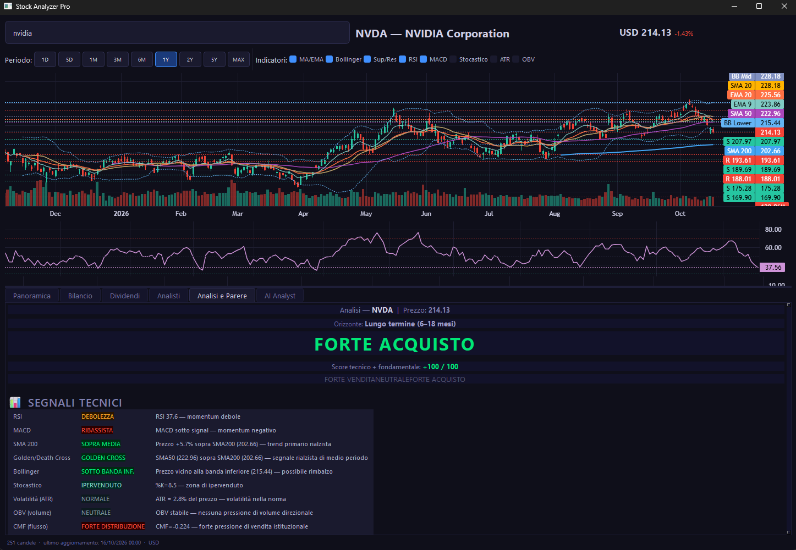

# Stock Analyzer Pro

A desktop app for **technical and fundamental analysis of any listed stock**, with an optional **AI analyst** (Google Gemini) that reads the same data you see on screen and writes a structured report. It is meant as one more input for your own investment plan, not as a replacement for it.

> **Disclaimer:** this is a personal/educational project. Nothing it shows is financial advice.



## Features

- **Ticker search and price data** via `yfinance`, with selectable time ranges (e.g. 3M).
- **Interactive candlestick charts** using TradingView Lightweight Charts, rendered inside the app (Qt WebEngine).
- **Technical indicators** computed with `pandas-ta`: SMA 20/50/200, EMA 9/20, Bollinger Bands, RSI, MACD, Stochastic, ATR, OBV, ADX (+DI/−DI) and Chaikin Money Flow.
- **Support/resistance detection**: local extrema found with SciPy (`argrelextrema`) and then clustered into price levels.
- **Fundamentals**: overview, financial statements, dividends and analyst consensus, each in its own tab.
- **Rule-based verdict ("Analisi e Parere")**: every indicator and fundamental metric produces a bullish/neutral/bearish signal. Signals are weighted differently for three horizons (short 1–4 weeks, medium 1–3 months, long 6–18 months) and combined into a score from **−100 to +100**. ATR-based entry/stop/target ideas are generated from the score and the support/resistance levels.
- **AI Analyst tab**: the app builds a detailed prompt from the market snapshot, fundamentals, analyst consensus, indicator table and key levels, and sends it to Gemini (with Google Search grounding, so the model looks up recent news first). The answer is a 9-section report with separate medium- and long-term verdicts. You can then keep asking follow-up questions in the same conversation.
- Responsive UI: network calls and AI requests run in background `QThread` workers.

> The interface and the AI prompt are currently in **Italian**.

## How the score works

Each signal contributes a number of points depending on its sentiment (±18 strong, ±9 mild, 0 neutral). Points are multiplied by a per-horizon weight, for example RSI ×2.5 on the short term but ×0.2 on the long term, while the 200-day SMA and Golden/Death Cross count ×2.0 on the long term and ×0.3/0.2 on the short term. Fundamental signals are scaled by a further 0.7. The final sum is clamped to [−100, +100].

The weights live in `analysis_engine.py` (`_HORIZON_W`), so they are easy to tune.

## Requirements

- Windows (the helper scripts are `.bat`; the Python code itself is not Windows-specific)
- Python 3.11+
- A [Gemini API key](https://aistudio.google.com/apikey) (only needed for the AI Analyst tab)

## Getting started

```bat
setup.bat      :: creates a virtualenv and installs requirements.txt
run.bat        :: starts the app
```

Or manually:

```bash
python -m venv venv
venv\Scripts\activate        # Linux/macOS: source venv/bin/activate
pip install -r requirements.txt
python main.py
```

### Gemini API key

Either set the `GEMINI_API_KEY` environment variable, or paste the key in the AI Analyst tab and press the save button: it is written to a local `.env` file next to the code. **Never commit that file** (it is listed in `.gitignore`).

### Build a standalone .exe (optional)

```bat
build.bat
```

This runs PyInstaller and produces `dist\StockAnalyzerPro\StockAnalyzerPro.exe`. It is only for distribution: the app runs fine without it.

## Project structure

| File | Role |
|---|---|
| `main.py` | Entry point, dark theme |
| `main_window.py` | Main window, tabs, background workers |
| `data.py` | yfinance access: search, prices, fundamentals, dividends, financials, analyst data |
| `analysis.py` | Indicator computation and support/resistance detection |
| `analysis_engine.py` | Signals, per-horizon scoring, strategies, HTML report |
| `chart_lightweight.py` | TradingView Lightweight Charts integration |
| `ai_analyst.py` | Prompt builder, Gemini calls, follow-up chat, API key handling |

## Tech stack

Python · PyQt6 (+ WebEngine) · yfinance · pandas / NumPy · pandas-ta · SciPy · TradingView Lightweight Charts · Google Gemini (`google-genai`) · PyInstaller

## About the development

I designed the features and the analysis logic and I developed the app with the help of AI coding tools.

## Limitations

- Data comes from Yahoo Finance through `yfinance`: it can be delayed, incomplete or occasionally unavailable.
- Technical signals are heuristics and the AI output can be wrong. Always double-check before acting.